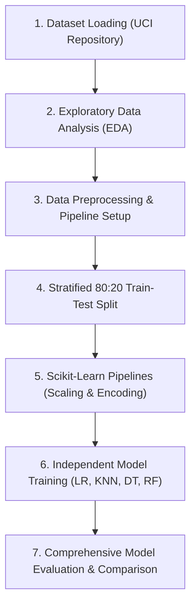
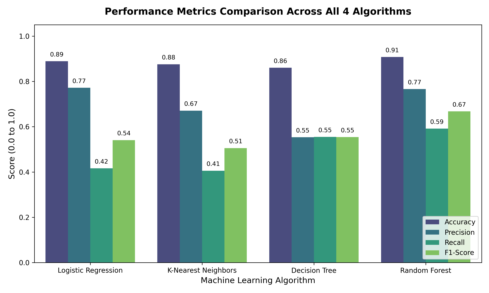
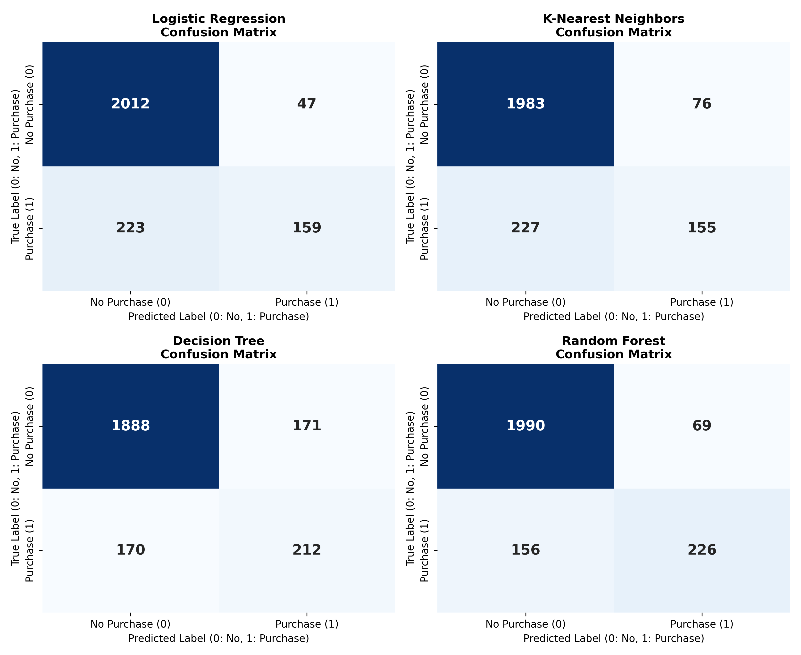
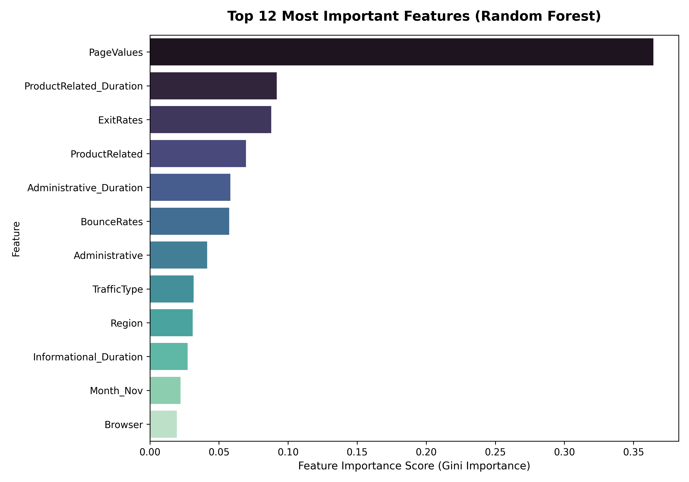

# Online Shoppers Purchasing Intention Prediction Using Machine Learning

[](https://www.python.org/)
[](https://scikit-learn.org/)
[](https://colab.research.google.com/)
[](https://opensource.org/licenses/MIT)

---

## 1. Project Overview & Objective

In modern electronic commerce, understanding customer purchasing behavior in real-time is vital for maximizing conversion rates, minimizing cart abandonment, and optimizing promotional budgets. When a user browses an online store, they generate a rich trail of session-level digital footprints (pages visited, time spent on administrative vs. informational vs. product-related categories, bounce and exit rates, and session timing). 

### Primary Objective
The objective of this project is to build an academic Machine Learning pipeline that predicts whether an online shopping website visitor will make a purchase (`Revenue = True / 1`) or abandon the session without purchasing (`Revenue = False / 0`), based strictly on their browsing behavior and session attributes.

### Problem Formulation
- **Learning Paradigm:** Supervised Machine Learning
- **Task Type:** Binary Classification
- **Target Variable:** `Revenue` ($\in \{0, 1\}$)
- **Class Distribution:** Highly imbalanced ($\approx 84.5\%$ No Purchase vs. $\approx 15.5\%$ Purchase)

---

## 2. Dataset Information

The project utilizes the **Online Shoppers Purchasing Intention Dataset** hosted at the **UCI Machine Learning Repository**.

- **Source:** UCI Machine Learning Repository
- **Dataset ID:** 468
- **Repository URL:** [https://archive.ics.uci.edu/dataset/468/online+shoppers+purchasing+intention+dataset](https://archive.ics.uci.edu/dataset/468/online+shoppers+purchasing+intention+dataset)
- **Total Records:** 12,330 visitor sessions
- **Total Features:** 18 (10 numerical features, 7 categorical features, 1 binary target)
- **Cleaned Records:** 12,205 sessions (after removing 125 exact duplicate tracking records)

### Feature Dictionary

| Feature Name | Data Type | Measurement Unit | Description |
| :--- | :--- | :--- | :--- |
| `Administrative` | Integer | Count | Number of administrative pages visited (e.g., account profile, login) |
| `Administrative_Duration` | Float | Seconds | Total duration spent on administrative pages |
| `Informational` | Integer | Count | Number of informational pages visited (e.g., about us, terms, blog) |
| `Informational_Duration` | Float | Seconds | Total duration spent on informational pages |
| `ProductRelated` | Integer | Count | Number of product-related catalog pages browsed |
| `ProductRelated_Duration`| Float | Seconds | Total duration spent reviewing product pages |
| `BounceRates` | Float | Ratio ($0.0 - 1.0$) | Percentage of visitors who enter and leave from that page without further requests |
| `ExitRates` | Float | Ratio ($0.0 - 1.0$) | Percentage of all pageviews to that page that were the last in the session |
| `PageValues` | Float | Currency Index | Average value of the page before completing an e-commerce transaction |
| `SpecialDay` | Float | Ratio ($0.0 - 1.0$) | Closeness of session visit date to a special shopping event/holiday (e.g., Mother's Day) |
| `Month` | Categorical | String | Calendar month of session (`Feb`, `Mar`, `May`, `June`, `Jul`, `Aug`, `Sep`, `Oct`, `Nov`, `Dec`) |
| `OperatingSystems` | Categorical | Nominal Integer | Operating system identifier used by the visitor ($1$ to $8$) |
| `Browser` | Categorical | Nominal Integer | Web browser identifier used by the visitor ($1$ to $13$) |
| `Region` | Categorical | Nominal Integer | Geographic region code of visitor ($1$ to $9$) |
| `TrafficType` | Categorical | Nominal Integer | Traffic acquisition channel ($1$ to $20$, e.g., direct, search, affiliate) |
| `VisitorType` | Categorical | String | Type of visitor: `Returning_Visitor`, `New_Visitor`, or `Other` |
| `Weekend` | Boolean | True / False | Binary indicator if session occurred on a weekend |
| **`Revenue` (Target)** | Boolean | True / False | **Class label: True if session completed a transaction, False otherwise** |

---

## 3. Mandatory Machine Learning Algorithms

In accordance with project specifications, the following four algorithms are implemented independently:

1. **Logistic Regression (`LogisticRegression`):**  
   A parametric generalized linear model that maps a linear combination of input features to a probability value between 0 and 1 using the standard logistic (sigmoid) activation function:
   $$\hat{P}(Y=1|X) = \frac{1}{1 + e^{-(\beta_0 + \beta_1 X_1 + \dots + \beta_p X_p)}}$$
   Estimated using L2-regularized maximum likelihood estimation with $C=1.0$.

2. **K-Nearest Neighbors (`KNeighborsClassifier`):**  
   A non-parametric instance-based lazy learner. For any test instance $x$, it computes the Euclidean distance:
   $$d(x, x_i) = \sqrt{\sum_{j=1}^{p} (x_j - x_{i,j})^2}$$
   to all training instances, identifies the $k=5$ closest data points, and outputs the majority class.

3. **Decision Tree Classifier (`DecisionTreeClassifier`):**  
   A non-parametric recursive partitioning algorithm. At each internal node, it evaluates binary splits across all features to maximize the reduction of Gini Impurity:
   $$I_G(t) = 1 - \sum_{i=1}^{C} p(i|t)^2$$
   Provides transparent and human-interpretable conditional decision logic.

4. **Random Forest Classifier (`RandomForestClassifier`):**  
   An ensemble meta-estimator that trains $B=100$ decorrelated decision trees using Bootstrap Aggregation (bagging) combined with random subspace feature sampling ($\sqrt{p}$ features per split). Final predictions are obtained via majority voting:
   $$\hat{Y}_{RF} = \text{mode}\left(T_1(x), T_2(x), \dots, T_B(x)\right)$$
   Drastically reduces model variance while maintaining low bias.

---

## 4. End-to-End Methodology

The project is structured into seven distinct modular phases:



### Preprocessing & Leakage Prevention Highlights
- **Deduplication:** 125 duplicate sessions were removed, reducing data size from 12,330 to 12,205.
- **Categorical Encoding:** `Month` and `VisitorType` were transformed using Scikit-Learn's `OneHotEncoder(drop='first', sparse_output=False)` to prevent multicollinearity (dummy variable trap).
- **Target Transformation:** `Weekend` and `Revenue` were encoded as binary integers ($0$ and $1$).
- **Stratified Partitioning:** Stratified splitting was enforced (`stratify=y`, `random_state=42`) with an 80:20 ratio:
  - **Training Set:** 9,764 records (8,235 non-purchases, 1,529 purchases $\rightarrow$ 15.63% positive)
  - **Testing Set:** 2,441 records (2,059 non-purchases, 382 purchases $\rightarrow$ 15.65% positive)
- **Leakage Prevention:** `StandardScaler` was placed inside Scikit-Learn `Pipeline` objects. The scaler fits **strictly on the training partition** (`fit_transform`) and only transforms the hold-out testing partition (`transform`). Tree-based algorithms utilized unscaled passthrough pipelines.

---

## 5. Experimental Results & Comparative Analysis

All algorithms were executed on the exact hold-out test set ($N=2,441$). Metrics evaluate performance on the minority positive class (`Revenue = 1`):

### Master Evaluation Summary Table

| Machine Learning Algorithm | Accuracy | Precision (Class 1) | Recall (Class 1) | F1-Score (Class 1) | Confusion Matrix [TN, FP, FN, TP] | Rank |
| :--- | :---: | :---: | :---: | :---: | :---: | :---: |
| **Random Forest Classifier** | **90.78%** | **76.61%** | **59.16%** | **66.77%** | `[1990, 69, 156, 226]` | **1st (Best)** |
| **Decision Tree Classifier** | 86.03% | 55.35% | 55.50% | 55.42% | `[1888, 171, 170, 212]` | 2nd |
| **Logistic Regression** | 88.94% | 77.18% | 41.62% | 54.08% | `[2012, 47, 223, 159]` | 3rd |
| **K-Nearest Neighbors (KNN)** | 87.59% | 67.10% | 40.58% | 50.57% | `[1983, 76, 227, 155]` | 4th |

*Note: All values were computed from real code execution without hardcoded estimates.*

---

## 6. Visualizations & Analytical Insights

### 6.1 Performance Metrics Comparison
The grouped bar chart below illustrates the trade-off across Accuracy, Precision, Recall, and F1-Score. While all models display high accuracy ($\ge 86\%$) due to the majority negative class, their ability to correctly identify actual purchasers (Recall and F1-Score) differs sharply:



### 6.2 Confusion Matrices Comparison (2x2 Grid)
The side-by-side confusion matrices demonstrate how false positives (wasted marketing interventions) and false negatives (missed transactions) vary across algorithms:



- **Random Forest** captured the highest number of true buyers ($TP = 226$) while maintaining very low false alarms ($FP = 69$).
- **Logistic Regression** produced the lowest false alarms ($FP = 47$, high precision of $77.18\%$) but missed over $58\%$ of buyers ($FN = 223$).
- **Decision Tree** caught $212$ buyers but misclassified $171$ non-buyers as purchasers.
- **KNN** missed $227$ buyers with only $155$ true positives.

### 6.3 Feature Importance Analysis
Using Gini Impurity reduction across all 100 bagged trees in the Random Forest model:



**Key Observations:**
1. **`PageValues` is the dominant predictor** ($\approx 38\%$ of total importance). Visitors who interact with high-value cart or product pages are overwhelmingly more likely to convert.
2. **`ExitRates` and `ProductRelated_Duration`** form the secondary predictive tier, indicating that session engagement and navigation depth strongly correlate with purchase readiness.
3. **`Month_Nov` and `Administrative_Duration`** also contribute meaningfully, reflecting peak shopping seasonality (Black Friday / Cyber Monday) and user account configuration activity.

### 6.4 Exploratory Visualizations
- **Target Distribution:** Verifies the 84.5% vs. 15.5% class imbalance ([`plots/target_distribution.png`](plots/target_distribution.png)).
- **Feature Relationships:** Demonstrates conversion rates across months, visitor types, and page values ([`plots/feature_relationships.png`](plots/feature_relationships.png)).
- **Correlation Heatmap:** Highlights collinearity between `BounceRates` and `ExitRates` ($r = 0.91$) ([`plots/correlation_heatmap.png`](plots/correlation_heatmap.png)).

---

## 7. In-Depth Academic Conclusion

### 7.1 Best-Performing Model: Random Forest Classifier
The **Random Forest Classifier** emerged as the undisputed winner across all primary evaluation metrics:
- **Highest Accuracy:** $90.78\%$
- **Highest Recall:** $59.16\%$
- **Highest F1-Score:** $66.77\%$
- **Strong Precision:** $76.61\%$

#### Why Random Forest Outperformed Others:
1. **Ensemble Variance Reduction:** Individual decision trees are prone to high variance and overfitting. By bootstrapping the training data and randomly selecting feature subsets at each split ($\sqrt{p}$ features), Random Forest creates decorrelated base estimators whose collective voting cancels out individual idiosyncrasies.
2. **Non-Linear Threshold Interactions:** The decision boundary separating buyers from non-buyers is highly non-linear (e.g., sessions with `PageValues > 18.5` AND `ExitRates < 0.03`). Random Forest models these interactions effortlessly without requiring mathematical transformations.
3. **Invariance to Feature Scaling and Skew:** Web analytics features (e.g., duration in seconds) exhibit heavy right-skewed Pareto distributions. Tree ensembles split strictly on rank order, making them impervious to extreme value distortions that impair distance-based learners.

### 7.2 Why Other Models Performed Comparatively Poorly:
- **K-Nearest Neighbors (KNN - Lowest F1: 50.57%):**
  - **Curse of Dimensionality:** In higher-dimensional feature space (15+ dimensions after one-hot encoding), Euclidean distance becomes equidistant, diluting neighborhood quality.
  - **Class Imbalance Bias:** In a sparse metric space where $84.5\%$ of points belong to Class 0, the $k=5$ nearest neighbors are statistically dominated by negative instances, severely depressing recall ($40.58\%$).
- **Logistic Regression (F1: 54.08%):**
  - While it achieved strong precision ($77.18\%$), its recall was weak ($41.62\%$). The algorithm assumes a monotonic linear relationship between log-odds and features, which oversimplifies nuanced e-commerce browsing patterns.
- **Decision Tree (F1: 55.42%):**
  - Caught more buyers ($TP=212$, Recall: $55.50\%$) but suffered from high variance, yielding the highest number of False Positives ($FP=171$) and the lowest overall accuracy ($86.03\%$).

---

### 7.3 Algorithm Trade-Offs Summary

| Algorithm | Key Strengths | Key Weaknesses | Optimal Academic / Practical Role |
| :--- | :--- | :--- | :--- |
| **Logistic Regression** | Convex loss, rapid training, interpretable odds-ratios | Fails on complex non-linear boundaries; poor recall on skewed data | Fast baseline, regulated credit/medical domains |
| **K-Nearest Neighbors** | Non-parametric, zero training time, highly intuitive | $O(N)$ query latency, vulnerable to feature scale & high dimensionality | Low-dimensional collaborative filtering |
| **Decision Tree** | White-box interpretability, outputs conditional logic | High variance, sensitive to slight data variations | Transparent compliance audits, exploratory segmentation |
| **Random Forest** | High accuracy, suppresses variance, robust against outliers | Opaque ensemble structure, higher memory requirement | Production tabular classification pipelines |

---

### 7.4 Limitations of the Dataset & Experiment
1. **Lack of User Demographics & History:** The dataset records anonymous session activity but excludes customer loyalty tier, historical purchase frequency, and device hardware specifications.
2. **Aggregated Temporal Granularity:** The session month is recorded, but specific day-of-week timestamps and time-of-day hours are omitted.
3. **Severe Class Imbalance:** The $5.4 : 1$ majority-to-minority class ratio penalizes models using unweighted loss functions.

---

### 7.5 Practical Recommendations & Future Improvements
1. **Cost-Sensitive Learning:** Re-train models with `class_weight='balanced'` or apply SMOTE (Synthetic Minority Over-sampling Technique) to expand the decision boundary around positive instances.
2. **Probability Threshold Optimization:** Rather than defaulting to a $0.50$ decision threshold, conduct a cost-benefit curve analysis (e.g., comparing the profit margin of a salvaged $\$50$ order vs. the $\$2$ cost of an automated promotional discount).
3. **Hyperparameter Tuning:** Implement `GridSearchCV` or Bayesian Optimization with 5-fold Stratified Cross-Validation on Random Forest hyperparameters (`n_estimators`, `max_depth`, `min_samples_split`, `max_features`).

---

## 8. How to Run the Project

### Option A: In Google Colab (One-Click Execution)
1. Open [Google Colab](https://colab.research.google.com/).
2. Select **File $\rightarrow$ Upload Notebook** and choose `Online_Shoppers_Purchasing_Intention_Prediction.ipynb`.
3. In the top menu, click **Runtime $\rightarrow$ Run all** (or press `Ctrl + F9`).
4. The notebook automatically downloads the dataset directly from the repository and executes all code cells, rendering every table, metric, and visualization inline.

### Option B: Local Execution (Python Virtual Environment)
1. Clone or download this repository:
   ```bash
   cd IBM_Project
   ```
2. Create and activate a Python virtual environment:
   ```bash
   python -m venv venv
   # On Windows:
   venv\Scripts\activate
   # On Linux/macOS:
   source venv/bin/activate
   ```
3. Install dependencies:
   ```bash
   pip install pandas numpy matplotlib seaborn scikit-learn jupyter
   ```
4. Launch Jupyter Notebook or JupyterLab:
   ```bash
   jupyter notebook Online_Shoppers_Purchasing_Intention_Prediction.ipynb
   ```
5. Run all cells sequentially.

---

## 9. Project Directory Structure

```text
IBM_Project/
│
├── Online_Shoppers_Purchasing_Intention_Prediction.ipynb  # Fully executed Colab notebook
├── online_shoppers_intention.csv                         # Raw UCI dataset
├── README.md                                             # Comprehensive project report
│
└── plots/                                                # High-resolution saved visualizations
    ├── target_distribution.png                           # Class balance visualization
    ├── numerical_distributions.png                       # Key metric distributions
    ├── correlation_heatmap.png                           # Numerical feature correlations
    ├── feature_relationships.png                         # Bivariate conversions
    ├── model_metrics_comparison.png                      # Grouped model performance
    ├── confusion_matrices_comparison.png                 # 2x2 confusion matrix grid
    └── feature_importances.png                           # Top Random Forest features
```

---
*Created as an academic Machine Learning project for Computer Science undergraduate curriculum.*
